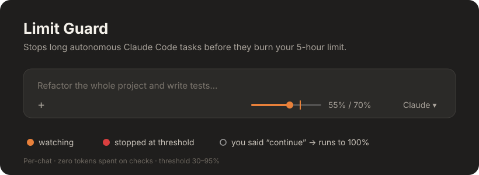

<div align="center">

# 🟠 Limit Guard

**Leave Claude Code working while you're away, and come back to some of your 5-hour limit still left.**

Limit Guard is a Claude Code mod. It stops a long autonomous task when your 5-hour usage reaches a threshold you pick (70% by default). It only applies to the chat where you switched it on.



</div>

---

## Why

You give Claude a big task: "refactor the project, write the tests, fix everything". Then you go to class, to sleep, or to make coffee. When you come back, the task finished hours ago and **your whole 5-hour window is gone**, so you can't use Claude for anything else.

Limit Guard sets a ceiling on autonomous work. When the threshold is reached it stops the task. To keep going, you just reply "continue".

## Features

- **A mini bar in the prompt footer.** It shows how much of the 5-hour window you've used, with a tick at your threshold. Click it to open the settings.
- **The dot shows the state:**
  - 🟠 watching
  - 🔴 stopped at the threshold
  - ⚪ off, or you said "continue" and it now runs to 100%
- **Per chat.** Turn it on in one chat and your other chats run as normal.
- **"Continue" overrides the stop.** If you write anything after a stop, the task runs to 100% until the window resets.
- **Background launches setting.** You choose whether scheduled tasks, background notifications and other agents' messages are blocked or allowed once you're over the threshold.
- **No tokens spent on checks.** Claude Code pushes usage updates to the mod whenever the number moves a whole point. Nothing is polled and the model is never called.
- **Adjustable threshold** from 30% to 95%, in the panel or with a command.

## Install

In Claude Code:

```
/plugin install limit-guard --marketplace egoricon/claude-limit-guard
```

Answer `y` to add the marketplace, then pick a scope (just you, or the project).

> Requires a Claude Code version with mod support, signed in with a Pro / Max / Team subscription. Usage numbers only exist on a subscription.

## Usage

| What | How |
| --- | --- |
| Open the settings | click `55% / 70%` in the prompt footer, or run `/limit-guard` |
| Turn on / off | **Enable** button, or `/limit-guard on` / `/limit-guard off` |
| Set the threshold | dropdown in the panel, or `/limit-guard 80` |
| Background launches over the threshold | **blocked / allowed** button, or `/limit-guard bg on` / `/limit-guard bg off` |
| Continue after a stop | just write "continue" |

## How it works

```
Claude Code ──(usage moved by 1 point)──▶ session.measure ──▶ percent ≥ threshold?
                                                                 │ yes, and a task is running
                                                                 ▼
                                                 stop the turn + notice in chat 🔴
your next message ──▶ lifts the stop, runs to 100% ──▶ new 5-hour window resets this
```

- Settings and state live in the session (`$.state`), so each chat has its own.
- Only autonomous work gets stopped. A message you write yourself is never blocked.
- A stop can land a point or two past the threshold if Claude was in the middle of a long action.

## Development

```bash
claude plugin validate .
claude plugin test .
```

The code is in `hooks/register.tsx` and the tests are in `tests/`.

---

<details>
<summary><b>🇷🇺 На русском</b></summary>

**Limit Guard** — мод для Claude Code. Он останавливает длинную автономную задачу, когда 5-часовой лимит доходит до выбранного порога (по умолчанию 70%). Работает только в том чате, где ты его включил.

- Внизу у поля ввода появляется мини-ползунок: сколько лимита израсходовано и где стоит порог. Если нажать на него, откроются настройки.
- 🟠 мод следит · 🔴 задача остановлена · ⚪ мод выключен или разрешено работать до 100%.
- Если после остановки написать «продолжи», задача пойдёт дальше до 100%.
- Есть настройка: пускать ли выше порога фоновые запуски (задачи по расписанию, уведомления).
- На проверки мод не тратит ни одного токена.

Установка: `/plugin install limit-guard --marketplace egoricon/claude-limit-guard`

</details>

<div align="center">

If Limit Guard saved your limit, please give it a ⭐

MIT License

</div>
